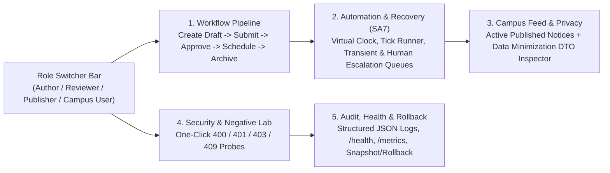

# Week 13 Automation Foundation — SA7

## 1. Workflow Boundary & Bounded Scope
The **Campus Announcement Scheduler (Project 26)** governs the lifecycle of campus-wide and targeted announcements from initial authoring through automated publication, automatic expiration, and archival.

### In-Scope Bounded States
| State (`wireName`) | Owner / Actor | Entry Trigger | Exit Trigger |
| :--- | :--- | :--- | :--- |
| `draft` | Content Author (`author`) | `POST /api/v1/announcements` | Author invokes `/submit` |
| `in_review` | Reviewer (`reviewer`) | Author submits draft | Reviewer invokes `/review` (`approve` or `reject`) |
| `rejected` | Content Author (`author`) | Reviewer rejects with mandatory notes | Author edits (`PUT`) and resubmits (`/submit`) |
| `approved` | Publisher (`publisher`) | Reviewer approves | Publisher invokes `/schedule` (passes conflict check) |
| `scheduled` | Automation Engine (`system`) | Publisher sets `[publishAt, expiresAt]` | Scheduler tick evaluates `publishAt <= now` |
| `publish_failed_transient` | Automation Engine (`system`) | Downstream gateway transient failure (`attempt < 3`) | Exponential backoff timer elapses; retry tick executes |
| `publish_failed_permanent` | Publisher (`publisher`) | Permanent downstream error OR `retryCount >= 3` | Publisher invokes `/recover` (Human Action) or `/archive` |
| `published` | Campus Users / System | Publication succeeds | Scheduler tick evaluates `expiresAt <= now` |
| `expired` | Publisher (`publisher`) | `expiresAt <= now` reached | Publisher invokes `/archive` |
| `archived` | Terminal State | Publisher archives expired announcement | None (Terminal immutable state) |

### Out-of-Scope Boundaries
- External SMS/email carrier billing integration (simulated deterministically via gateway modes `none`, `transient_once`, and `permanent_failure`).
- Multi-tenant cross-university federation.

---

## 2. Automation Trigger Decision
We implemented a **Hybrid Dual-Trigger Architecture** in `lib/backend/automation/automation_engine.dart` and `bin/server.dart`:
1. **Periodic Background Timer (`Timer.periodic` every 30s in `bin/server.dart`)**: Continuously polls for `scheduled` announcements where `publishAt <= now`, `publish_failed_transient` announcements where `nextRetryAt <= now`, and `published` announcements where `expiresAt <= now`.
2. **Deterministic On-Demand & Virtual-Clock Trigger (`POST /api/v1/automation/tick`)**: Allows authorized Publishers and automated test suites to advance the virtual clock (`advanceMinutes`, `advanceSeconds`) and execute a scheduler cycle immediately without waiting hours during live evaluations.

---

## 3. Flutter Web Screen Flow


---

## 4. Schedule Conflict Detection Policy
Before an `approved` announcement transitions to `scheduled` (`lib/backend/automation/conflict_detector.dart`), `ConflictDetector.evaluate` checks all active (`scheduled`, `publish_failed_transient`, `published`) announcements with overlapping `[publishAt, expiresAt]` windows (`publishAt < other.expiresAt && expiresAt > other.publishAt`):
1. **Rule 1 — Pinned Slot Exclusivity**: Two `pinned: true` announcements in the same `category` and `targetAudience` cannot overlap (`HTTP 409 SCHEDULE_CONFLICT`).
2. **Rule 2 — Duplicate Title Collision**: Two announcements with the same normalized title in the same `category` cannot overlap (`HTTP 409 SCHEDULE_CONFLICT`).

---

## 5. Retry & Recovery Policy
Implemented in `AutomationEngine._processPublicationAttempt` (`lib/backend/automation/automation_engine.dart`):
- **Maximum Automated Attempts**: `maxRetryAttempts = 3`
- **Backoff Formula**: Exponential backoff $\text{delay} = 5\text{s} \times 2^{(\text{attempt} - 1)}$ (`5s`, `10s`, `20s`).
- **Transient Failure Path**: Transitions to `publish_failed_transient`, increments `retryCount`, records `nextRetryAt`, and automatically re-attempts on the next eligible tick.
- **Permanent Failure / Exhaustion Path**: Immediately transitions to `publish_failed_permanent`, halts automated retries, and routes the announcement to the **Publisher Human Action Queue** (`POST /api/v1/announcements/:id/recover`).

---

## 6. Structured Audit Log Evidence

### 6.1 Recovered Transient Failure (`ANN-103`)
```json
[
  {
    "id": "AUD-1002",
    "timestamp": "2026-11-04T13:36:00.000Z",
    "correlationId": "corr-10002",
    "actorId": "automation-scheduler",
    "actorRole": "system",
    "action": "PUBLISH_ATTEMPT_FAILED_TRANSIENT",
    "announcementId": "ANN-103",
    "previousStatus": "scheduled",
    "newStatus": "publish_failed_transient",
    "outcome": "FAILURE_TRANSIENT",
    "details": {
      "title": "Cybersecurity MFA Upgrade Window for Student Portal",
      "attempt": 1,
      "maxRetries": 3,
      "backoffSeconds": 5,
      "nextRetryAt": "2026-11-04T13:36:05.000Z",
      "error": "GATEWAY_TIMEOUT_503: Campus Push Notification Gateway timed out (transient network blip). Scheduled automatic retry."
    }
  },
  {
    "id": "AUD-1004",
    "timestamp": "2026-11-04T13:36:10.000Z",
    "correlationId": "corr-10003",
    "actorId": "automation-scheduler",
    "actorRole": "system",
    "action": "PUBLISH_RECOVERED_AFTER_RETRY",
    "announcementId": "ANN-103",
    "previousStatus": "publish_failed_transient",
    "newStatus": "published",
    "outcome": "SUCCESS",
    "details": {
      "title": "Cybersecurity MFA Upgrade Window for Student Portal",
      "recoveredOnAttempt": 2,
      "previousErrorResolved": "GATEWAY_TIMEOUT_503: Campus Push Notification Gateway timed out (transient network blip). Scheduled automatic retry.",
      "publishedAt": "2026-11-04T13:36:10.000Z"
    }
  }
]
```

### 6.2 Permanent Failure Routed for Human Action (`ANN-104`) & Subsequent Human Resolution
```json
[
  {
    "id": "AUD-1003",
    "timestamp": "2026-11-04T13:36:00.000Z",
    "correlationId": "corr-10002",
    "actorId": "automation-scheduler",
    "actorRole": "system",
    "action": "PUBLISH_FAILED_PERMANENT_ESCALATED",
    "announcementId": "ANN-104",
    "previousStatus": "scheduled",
    "newStatus": "publish_failed_permanent",
    "outcome": "FAILURE_PERMANENT",
    "details": {
      "title": "Emergency Severed Fiber Line — West Engineering Annex",
      "attempt": 1,
      "maxRetries": 3,
      "error": "DOWNSTREAM_GATEWAY_REJECTED_PERMANENT: Target emergency broadcast channel rejected payload schema (unrecoverable without publisher intervention).",
      "routedTo": "Publisher Human Escalation Queue"
    }
  },
  {
    "id": "AUD-1005",
    "timestamp": "2026-11-04T13:36:25.000Z",
    "correlationId": "corr-10004",
    "actorId": "usr-publisher-01",
    "actorRole": "publisher",
    "action": "HUMAN_RECOVERY_RESOLVED_PERMANENT_FAILURE",
    "announcementId": "ANN-104",
    "previousStatus": "publish_failed_permanent",
    "newStatus": "published",
    "outcome": "SUCCESS",
    "details": {
      "title": "Emergency Severed Fiber Line — West Engineering Annex",
      "previousError": "DOWNSTREAM_GATEWAY_REJECTED_PERMANENT: Target emergency broadcast channel rejected payload schema (unrecoverable without publisher intervention).",
      "resolutionNote": "Reconfigured emergency broadcast channel schema and verified delivery.",
      "publishImmediately": true
    }
  }
]
```

---

## 7. Maintainability Note
- **Pure-Dart Domain & Engine Separation**: `Announcement`, `AnnouncementValidator`, `ConflictDetector`, `AnnouncementRepository`, and `AutomationEngine` contain zero UI or `dart:io` couplings. They are unit-tested in isolation in `< 2 seconds` and shared across both the standalone HTTP server (`bin/server.dart`) and the Flutter Web offline fallback engine.
- **Explicit State Machine Matrix**: State transitions are declared in a single table in `AnnouncementValidator.validateStateTransition`, preventing ad-hoc status mutations across controllers.

