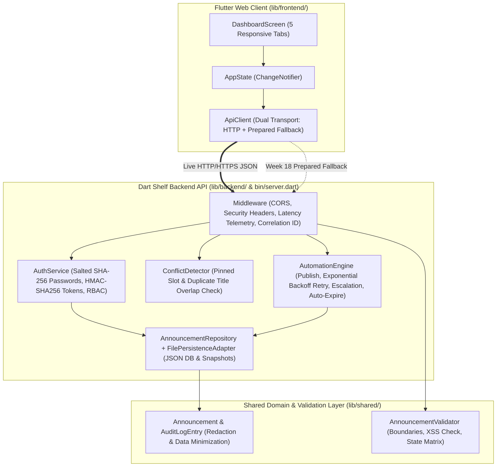
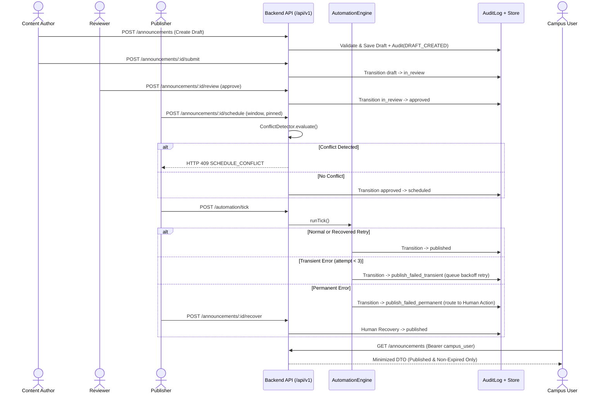

# Week 17 UAT, Documentation and Evaluation — SA9 and AS3

## 1. Controlled User Acceptance Testing (UAT) Scenarios & Findings

UAT was executed across 8 controlled scenarios covering all four user personas (**Content Author**, **Reviewer**, **Publisher**, and **Campus User**) plus negative, conflict, and failure recovery paths.

| UAT ID | Persona | Controlled Scenario Description | Expected Result | Observed Result | Disposition |
| :--- | :--- | :--- | :--- | :--- | :---: |
| **UAT-01** | Content Author (`author@campus.edu`) | Create draft `"Spring Semester Library Extended Study Hours"` and submit for review (`ANN-108`). | Status transitions `draft -> in_review`; audit log `SUBMITTED_FOR_REVIEW` recorded. | Matches expected; visible in Workflow Pipeline. | **Accepted** |
| **UAT-02** | Reviewer (`reviewer@campus.edu`) | Reject `ANN-106` without notes first (verify validation), then reject with note `"Please add room number"`. | Empty note rejected (`400`); note provided transitions `in_review -> rejected`. | Matches expected; clear error banner shown when note omitted. | **Accepted** |
| **UAT-03** | Reviewer & Publisher | Approve `ANN-105` as Reviewer, then schedule as Publisher with valid 24h window. | Transitions `in_review -> approved -> scheduled`. | Matches expected. | **Accepted** |
| **UAT-04** | Publisher (`publisher@campus.edu`) | Attempt to schedule a second `pinned: true` Academic announcement overlapping `ANN-101`. | Rejected with `HTTP 409 SCHEDULE_CONFLICT` identifying `ANN-101`. | Conflict banner displays exact conflicting ID and window. | **Accepted** |
| **UAT-05** | Publisher (`publisher@campus.edu`) | Execute Scheduler Tick 1 & Tick 2 to observe transient failure (`ANN-103`) and permanent failure (`ANN-104`). | `ANN-103` fails Tick 1 (`publish_failed_transient`) and auto-recovers on Tick 2 (`published`). `ANN-104` routes to Human Escalation Queue (`publish_failed_permanent`). | Both behaviors verified in Tab 2 and Audit Log. | **Accepted** |
| **UAT-06** | Publisher (`publisher@campus.edu`) | Resolve escalated permanent failure `ANN-104` via **"Human Action: Resolve & Recover"** modal. | `ANN-104` transitions `publish_failed_permanent -> published`; audit log records resolution note. | Matches expected; Health status returns from `DEGRADED_ACTION_REQUIRED` to `HEALTHY`. | **Accepted** |
| **UAT-07** | Publisher (`publisher@campus.edu`) | Fast-forward virtual clock `+25h` to trigger automatic expiration, then archive expired announcement. | Initial UAT defect (`UAT-DEF-01`): advancing virtual clock expired Publisher session token (`401`). | **Fixed & Retested**: Decoupled JWT wall-clock TTL from virtual schedule clock; archive succeeds (`200 OK`). | **Fixed & Accepted** |
| **UAT-08** | Campus User (`student@campus.edu`) | View Campus Feed and inspect JSON payload in Tab 3; attempt to access Audit Logs in Tab 5. | Only `published` non-expired items shown; internal fields stripped; Audit Logs restricted by RBAC. | Verified via Data Minimization DTO Inspector. | **Accepted** |

---

## 2. Architecture & Data-Flow Diagrams

### 2.1 System Architecture Diagram

### 2.2 End-to-End Data-Flow Diagram

---

## 3. Architecture Decision Records (ADRs) & Alternatives Evaluated

### ADR-01: Unified Dart Monorepo (Flutter Web + `package:shelf` Backend) vs. Separate Node/Python Backend
- **Decision**: Implement both the Flutter Web client and the REST API backend in Dart within a single repository.
- **Alternatives Considered**:
  1. *Flutter Web + Node.js/Express*: Requires maintaining two package managers (`pub` + `npm`), duplicate validation logic in TypeScript and Dart, and two separate runtimes in Android Studio.
  2. *Flutter Web + Python FastAPI*: Strong OpenAPI generation, but requires Python virtualenv management alongside Flutter SDK.
- **Justification**: Sharing `Announcement`, `AnnouncementValidator`, and `AuditLogEntry` in `lib/shared/` guarantees zero schema drift between client and server and allows the exact same `ServerApp` pipeline to run as a standalone HTTP server (`bin/server.dart`) or embedded inside Flutter Web for the Week 18 prepared fallback.

### ADR-02: JSON-Backed Repository with Snapshot/Rollback vs. External SQL Database
- **Decision**: Use an abstracted `StoragePersistenceAdapter` backed by deterministic JSON files (`data/announcements_db.json` and `data/announcements_snapshot.json`) plus in-memory test isolation.
- **Alternatives Considered**: External PostgreSQL or SQLite FFI binary.
- **Justification**: Eliminates external database setup barriers during academic grading, enables instant `< 20ms` point-in-time snapshot/rollback (`POST /api/v1/admin/rollback`), and compiles cleanly to Flutter Web without native C/FFI browser incompatibilities.

### ADR-03: Hybrid Periodic + Virtual-Clock Scheduler Trigger
- **Decision**: Combine a 30-second background `Timer.periodic` worker with a Publisher-controlled `POST /api/v1/automation/tick` virtual clock endpoint.
- **Justification**: Real-time cron jobs alone cannot demonstrate 24-hour automatic expiration or multi-step retry recovery during a 10-minute live defense without a virtual clock offset.

---

## 4. Known Limitations & Maintenance Plan

### Known Limitations
1. **Single-Writer Persistence**: `FilePersistenceAdapter` writes full state snapshots to disk synchronously and is intended for single-instance deployment (`< 10,000` announcements).
2. **Simulated Downstream Gateway**: Push/email delivery failures are controlled via `FailureSimulationMode` (`none`, `transient_once`, `permanent_failure`) rather than an external SMTP/FCM provider.
3. **In-Memory Metrics Window**: Rolling latency percentiles (`p50`/`p95`/`p99`) retain the most recent 2,000 requests in memory and reset on process restart.

### Maintenance Plan
- **Daily Automated Checks**: Run `flutter analyze` and `flutter test` on every pull request; monitor `/api/v1/health` for `"DEGRADED_ACTION_REQUIRED"` alerts whenever `escalationQueueDepth > 0`.
- **Weekly Operational Tasks**: Archive expired announcements older than 30 days (`POST /api/v1/announcements/:id/archive`) and create pre-deployment state snapshots (`POST /api/v1/admin/snapshot`).
- **Quarterly Security Tasks**: Rotate `JWT_HMAC_SECRET` in `.env`, review RBAC denial logs (`RBAC_AUTHORIZATION_DENIED`) in `/api/v1/audit-logs`, and run `flutter pub outdated` to apply security patches.

